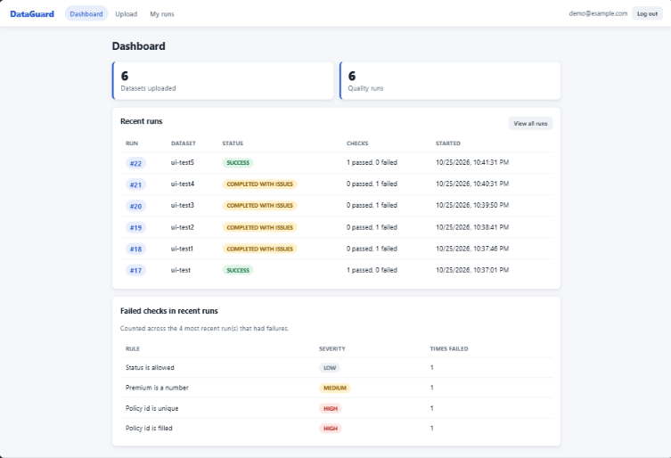
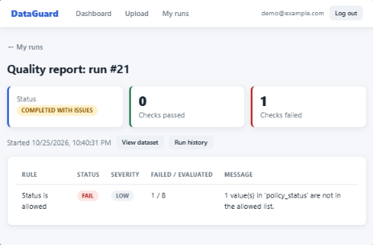
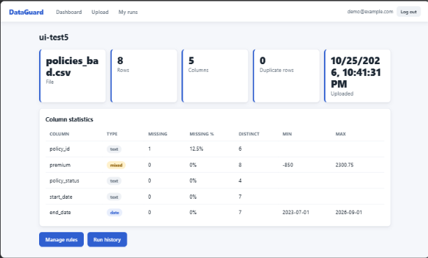
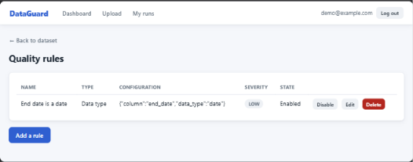
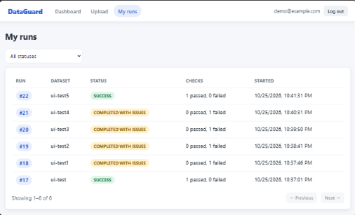
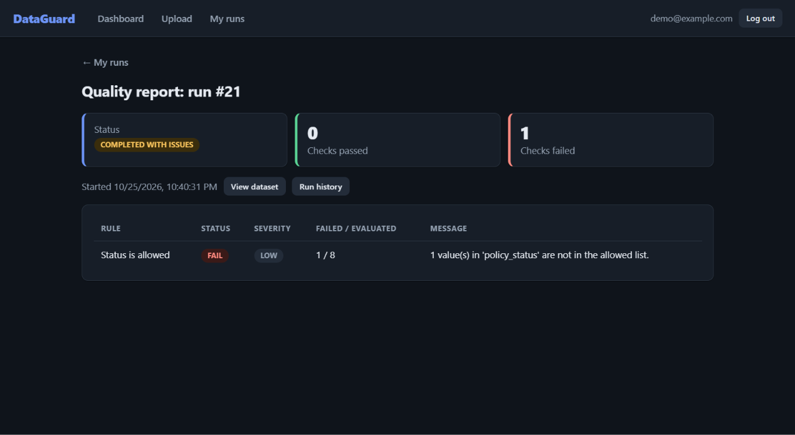

# DataGuard

A data quality monitoring app. Create an account, upload a CSV, get an automatic profile, define quality rules, run validation, and review reports and run history in a simple web interface.

> **Portfolio project.** Accounts and sessions are implemented (see [docs/security.md](docs/security.md)), but this is a demo, not a hardened service. Please do not upload sensitive data.

## Features

- Register and log in (email and password); every dataset, rule and run belongs to its owner
- CSV upload with validation (type, size, encoding, empty files, bad headers)
- Automatic profile: rows, columns, types, missing values, duplicates, distinct counts, numeric and date min/max
- Six configurable rule types: required columns, no missing values, no duplicate rows, numeric range, allowed values, data type
- PASS/FAIL results with severity (LOW, MEDIUM, HIGH), run history, and a "My runs" page with status filter
- Everything persisted in PostgreSQL; raw CSV rows are never stored
- REST API under `/api/v1` and a vanilla JavaScript frontend with light and dark themes

## Screenshots

| | |
|---|---|
|  |  |
|  |  |
|  |  |

More: [login](docs/screenshots/login.png), [upload](docs/screenshots/upload.png), [run history](docs/screenshots/run-history.png).

## Tech stack

Python 3.13, pandas, FastAPI, Pydantic v2, SQLAlchemy 2.x, psycopg, PostgreSQL 18, HTML/CSS/JavaScript (no framework), pytest.

## Setup (Windows PowerShell)

1. **Create the databases** (as the `postgres` superuser, in `psql`):

   ```sql
   CREATE ROLE dataguard_user WITH LOGIN PASSWORD 'choose_a_password';
   CREATE DATABASE dataguard OWNER dataguard_user;
   CREATE DATABASE dataguard_test OWNER dataguard_user;
   ```

2. **Create the virtual environment and install packages:**

   ```powershell
   python -m venv .venv
   .\.venv\Scripts\Activate.ps1
   pip install -r requirements.txt
   ```

3. **Configure:** copy `.env.example` to `.env` and fill in your password in **both** database URLs (they must use the same password). Use letters, digits and `_` so the URL stays valid. Never commit `.env`.

   ```powershell
   Copy-Item .env.example .env
   ```

4. **Check the connection and create the tables:**

   ```powershell
   python scripts\check_db.py
   python -m scripts.init_db
   ```

5. **Run the app:**

   ```powershell
   uvicorn app.main:app --reload
   ```

   Open http://127.0.0.1:8000/, choose **Create one** on the login screen, and register. Interactive API docs are at `/docs`.

### Upgrading a database created with V1

`init_db` only creates missing tables. A V1 database needs one extra step, which adds the owner column. It refuses to run while datasets exist:

```powershell
python -m scripts.init_db
python -m scripts.migrate_v2_ownership
```

## Settings

| Variable | Default | Meaning |
|---|---|---|
| `DATABASE_URL` | required | Development database |
| `TEST_DATABASE_URL` | none | Test database; must be named `dataguard_test` |
| `MAX_FILE_SIZE_MB` | 50 | Upload size limit |
| `SESSION_DAYS` | 7 | How long a login lasts |
| `COOKIE_SECURE` | false | Set `true` when served over HTTPS |
| `ALLOW_REGISTRATION` | true | Set `false` to close sign-ups |
| `LOG_LEVEL` | INFO | Logging level |

## Tests

```powershell
python -m pytest -q
```

Tests run against `dataguard_test` only. They refuse to start unless the database is named exactly `dataguard_test` and differs from the development database. The suite includes tests that prove users cannot read each other's data.

## Try it

Upload `sample_data/insurance/policies_bad.csv` or `sample_data/weather/weather_bad.csv`. Both contain planted problems (blank ids, duplicates, out-of-range numbers, a bad date). These are examples; DataGuard works on any CSV.

More: [usage](docs/usage.md), [architecture](docs/architecture.md), [database design](docs/database_design.md), [security](docs/security.md).