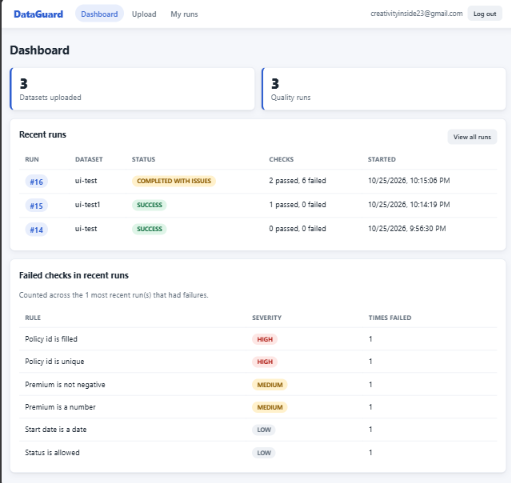
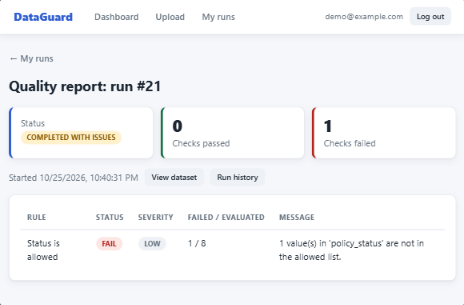
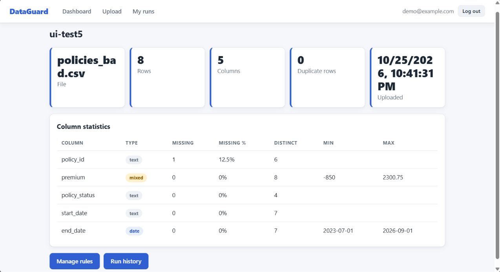
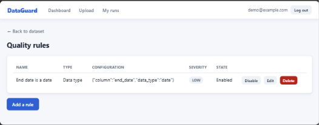
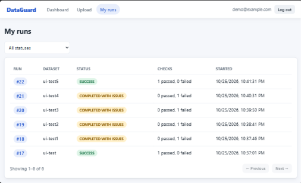
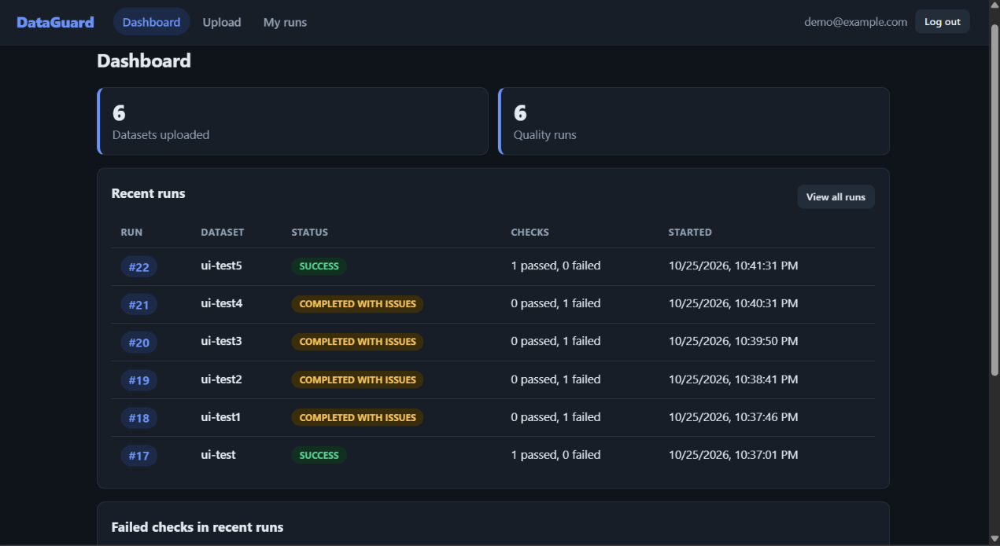

# DataGuard

A data quality and light ETL project. Upload a CSV, get an automatic profile, validate it against configurable rules, separate the **valid** rows from the **rejected** ones, and, if you choose, **load the valid rows into PostgreSQL** with an idempotent upsert, so running the same file twice changes nothing.

> **Portfolio project.** Accounts and sessions are implemented (see [docs/security.md](docs/security.md)), but this is a demo, not a hardened service. Please do not upload sensitive data.

## What it does

```
CSV -> extract -> profile -> validate -> split valid / rejected rows -> (optional) upsert valid rows -> report
```

- **Extraction checks:** file type, size, UTF-8, delimiter, header names, and the same number of fields in every row. A bad file is rejected with a clear message instead of being silently misread.
- **Profile:** rows, columns, inferred types, missing values, duplicates, distinct counts, numeric and date min and max.
- **Six rule types:** required columns, no missing values, no duplicate rows, numeric range, allowed values, data type. Each result is PASS or FAIL with a severity (LOW, MEDIUM, HIGH).
- **Schema failures versus quality failures:** a missing column judges the *file* and never rejects rows. A bad value judges a *row*.
- **Row accounting:** every run records rows read, valid and rejected. A row failing several rules is counted once, and the database itself enforces `valid + rejected = source`.
- **Optional loading (off by default):** give a dataset key columns and its valid rows are upserted into `dataset_records`. See [docs/data_loading.md](docs/data_loading.md).
- **Accounts:** each user sees only their own datasets, rules, runs and records.
- **Command line:** run the whole pipeline on a file with no web app and no database.
- **Migrations:** the schema is versioned with Alembic, and a test fails if the models and the migrations ever disagree.

## Screenshots

| | |
|---|---|
|  |  |
|  |  |
|  |  |

More: [login](docs/screenshots/login-page.png), [upload](docs/screenshots/upload.png), [run history](docs/screenshots/run-history.png), [report in dark mode](docs/screenshots/quality-report-dark.png).

## Tech stack

Python 3.13, pandas, FastAPI, Pydantic v2, SQLAlchemy 2.x, Alembic, psycopg, PostgreSQL 18, HTML/CSS/JavaScript (no framework), pytest.

## Setup (Windows PowerShell)

1. **Create the databases** (as the `postgres` superuser, in `psql`):

   ```sql
   CREATE ROLE dataguard_user WITH LOGIN PASSWORD 'choose_a_password';
   CREATE DATABASE dataguard OWNER dataguard_user;
   CREATE DATABASE dataguard_test OWNER dataguard_user;
   ```

2. **Create the virtual environment and install packages:**

   ```powershell
   python -m venv .venv
   .\.venv\Scripts\Activate.ps1
   pip install -r requirements.txt
   ```

3. **Configure:** copy `.env.example` to `.env` and fill in your password in **both** database URLs (they must use the same password). Use letters, digits and `_` so the URL stays valid. Never commit `.env`.

   ```powershell
   Copy-Item .env.example .env
   ```

4. **Check the connection and create the tables:**

   ```powershell
   python scripts\check_db.py
   alembic upgrade head
   ```

5. **Run the app:**

   ```powershell
   uvicorn app.main:app --reload
   ```

   Open http://127.0.0.1:8000/, choose **Create one** on the login screen, and register. Interactive API docs are at `/docs`.

### A database that already exists

If the tables were created before Alembic was used, tell Alembic which version they match, **once**, then upgrade. Stamp the revision that matches your tables, not `head`. See [docs/migrations.md](docs/migrations.md).

## Command line

No database is needed:

```powershell
python -m app.cli run sample_data/insurance/policies_bad.csv --rules sample_data/insurance/policies_bad.rules.json
```

It prints a report and exits with `0` (success), `1` (the run finished and a check failed) or `2` (the run could not complete). Add `--json` for the full report. Details: [docs/pipeline.md](docs/pipeline.md).

## Settings

| Variable | Default | Meaning |
|---|---|---|
| `APP_ENV` | development | A label for the environment |
| `DATABASE_URL` | required | Development database |
| `TEST_DATABASE_URL` | none | Test database; must be named `dataguard_test` |
| `MAX_FILE_SIZE_MB` | 50 | Upload size limit. Memory use is about 12 times the file size, so keep it well below your memory limit divided by 12 |
| `SESSION_DAYS` | 7 | How long a login lasts |
| `COOKIE_SECURE` | false | Set `true` when served over HTTPS |
| `ALLOW_REGISTRATION` | true | Set `false` to close sign-ups |
| `LOG_LEVEL` | INFO | Logging level |
| `STORE_SAMPLE_VALUES` | false | Set `true` to store up to 5 offending cell values per rule |

## Tests

```powershell
python -m pytest -q
```

Tests run against `dataguard_test` only. They refuse to start unless the database is named exactly `dataguard_test` and differs from the development database. Among other things they prove:

- one user cannot read, change or delete another user's data;
- an upload with a bad file or a bad rule saves nothing;
- a failed run is never reported as success, and a failure while loading leaves no half-loaded rows;
- loading the same file twice changes nothing the second time;
- the migrations build the same schema as the models, and an existing database is upgraded without losing data;
- the documentation matches the code (every endpoint, setting, table and migration is documented, and every link works).

`.\scripts\verify.ps1` runs the whole suite plus the command line in one go.

## Performance

Measured with `python -m scripts.benchmark` on one machine (a 1-CPU Linux sandbox, Python 3.12, pandas 3.0.2, seven rules, synthetic data), one run per size:

| rows | file | total time | peak memory |
|---:|---:|---:|---:|
| 100,000 | 4.7 MB | 0.9 s | 121 MB |
| 1,000,000 | 47 MB | 10.5 s | 595 MB |

Run the benchmark yourself to get numbers for your machine. Details and the full table are in [docs/pipeline.md](docs/pipeline.md).

## Known limitations

- Files are processed **in memory** on one machine. Peak memory is roughly 12 times the file size, so this is not suited to files that do not fit in memory.
- Loaded rows are stored as text in a JSONB column. Nothing is converted to numbers or dates, and querying a field needs JSON operators.
- A load never deletes: a record missing from a later file stays. Removing records means deleting all of them for a dataset.
- Dates are recognised only in ISO form without a time zone (`Z` and `+05:30` make a column `text`).
- The login rate limiter is in memory: it works for one server process and resets on restart.
- No email verification, password reset, CSRF tokens or per-user storage quota.
- There are no background jobs: a run happens inside the request, so a very large file blocks that request.
- The benchmark numbers above come from a Linux sandbox, not from Windows or from a hosting plan.

## Project layout

```
app/
  api/          FastAPI routes, dependencies and error handling
  core/         settings, constants, exceptions, logging, security helpers, the missing-value rule
  db/           SQLAlchemy base and session
  ingestion/    CSV extraction and validation
  models/       SQLAlchemy models
  processing/   the pure pipeline: runner, report, loading preparation (no FastAPI, no database)
  profiling/    profiler and column statistics
  quality/      rule engine: rules, registry, engine, result
  schemas/      Pydantic request and response models
  services/     database-backed logic: accounts, runs, loading
  cli.py        command line entry point
frontend/       HTML, CSS and vanilla JavaScript
migrations/     Alembic migrations
sample_data/    sample CSVs with planted problems, and matching rule files
scripts/        connection check, benchmark, verification, helpers
tests/          pytest suite
docs/           documentation and screenshots
```

## More documentation

[Usage](docs/usage.md), [architecture](docs/architecture.md), [pipeline and command line](docs/pipeline.md), [loading rows](docs/data_loading.md), [database design](docs/database_design.md), [migrations](docs/migrations.md), [data policies](docs/data_policies.md), [security](docs/security.md).
